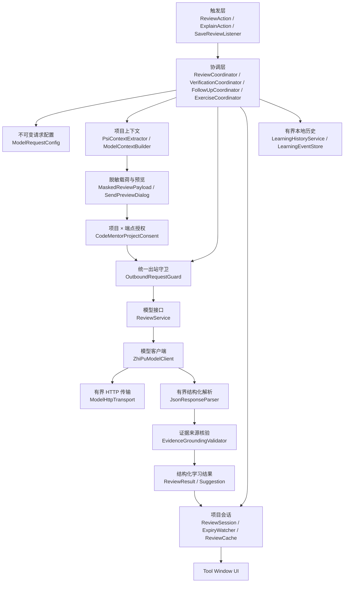

# CodeMentor 1.2.0 架构

发布基线日期：2026-08-22。

本文档描述当前代码，而不是开发路线图。CodeMentor 是 IntelliJ IDEA 2024.1.x 内的个人 Java / JavaWeb 学习插件，核心闭环是“发现问题 → 自己修改 → 再次验证 → 复习练习”。

## 1. 架构边界与不变量

CodeMentor 刻意不做自动改代码、项目命令执行、完整工程生成、服务端账号和云端学习历史。由此得到以下不变量：

1. 任何项目学习上下文发送前都必须匹配当前项目对规范化端点的授权。
2. 每个操作只使用启动时捕获的一份不可变模型配置，设置变化不能污染在途请求。
3. 项目外文件和命中排除规则的文件不进入 PSI 上下文采集与评审发送路径。
4. 预览与评审请求复用同一份脱敏载荷；遮盖是尽力保护，最终决定仍由用户作出。
5. 旧响应不能覆盖新状态；请求、验证、追问、练习和学习事件使用完整 UUID 关联。
6. 网络响应、模型字段、内存缓存和本地历史都有明确上限。
7. PSI、网络、PasswordSafe 和磁盘 I/O 不在 EDT 上执行；UI 状态只在 EDT 更新。
8. 模型建议中的代码证据必须同时存在于实际发送的脱敏上下文和脱敏目标源码；修改验证证据必须来自当前目标源码。无法核对的整次结构化结果不会进入会话、缓存或历史。
9. 追问问题与回答只属于当前内存会话，不写入学习历史或 Markdown 导出。

## 2. 组件与依赖方向

依赖方向保持单向：动作只负责找到编辑器目标并调用协调器；协调器拥有业务流程；模型客户端不直接操作 UI；本地历史不依赖模型响应对象中的代码证据。

## 3. 配置、端点和授权

### 3.1 不可变请求快照

`CodeMentorSettings` 只保存应用级非敏感配置。每个评审、验证、追问或练习开始时，协调器调用 `ModelRequestConfig.capture()`，一次性得到：

- 规范化模型端点；
- 模型名；
- 教学级别；
- 提示协议版本。

`ModelRequestConfig` 是 Java record，随后会沿协调器、缓存、`ReviewService`、请求体构造和 HTTP 传输一路传递。即使用户在请求期间打开设置页修改端点或模型，这个请求也不会混用新旧配置。缓存键同样包含端点、模型、教学级别和提示协议版本，防止跨配置复用结果。

### 3.2 端点校验

`ModelEndpointValidator` 在捕获配置和测试连接前执行同一套规则：

- 端点必须包含协议、主机和请求路径；
- 拒绝 URL 用户名/密码、查询参数、片段、非法端口、控制字符和过长输入；
- 默认只允许 HTTPS；
- 只有设置中显式允许后，HTTP 才可指向 `localhost`、`127.0.0.0/8` 或 `::1`；
- 普通远程 HTTP 和伪装成 localhost 子域名的地址始终拒绝；
- 模型名也会执行长度、控制字符和允许字符校验。

### 3.3 项目与端点绑定的授权

`CodeMentorProjectConsent` 是 project-level service，授权值写入该项目的 workspace 元数据。它只保存当前获准的规范化端点，不保存 API Key，也不按模型名授权。

首次需要发送缓存未命中的手动评审或解释时，`ReviewCoordinator` 展示脱敏上下文和目标端点；用户选择“发送并记住此地址”后才写入授权。端点不匹配时，所有新的网络学习请求都会被出站守卫拒绝；用户需要通过手动评审/解释为新端点完成确认。授予另一个端点会替换该项目当前保存的端点。纯本地缓存命中不发送网络请求，因此可以在未授权时显示缓存结果。

侧栏“隐私与数据”可撤销当前项目授权；设置页可撤销所有已打开项目的授权。撤销会调用 `ReviewCoordinator.cancelAll()`：generation 失效，评审管线与验证/追问/练习收到取消请求，session 被重置，后续派发也会被拒绝。`Future.cancel(true)` 和 HTTP 中断属于尽力而为，无法撤回已经到达模型服务的内容。

设置页更换端点、关闭总功能开关或成功更改/清除 API Key 时，也会对所有已打开项目执行同一取消流程。单次请求仍依赖自身的不可变配置快照，模型名等其他设置变化不会悄悄改写已捕获的快照。

## 4. 出站数据路径

### 4.1 采集前边界

`ProjectFilePath` 先将目标解析为项目相对路径，并标记它是否真正位于项目根内。`OutboundRequestGuard.evaluateFile()` 在 PSI 和 `.codementor/rules.md` 读取前检查项目边界及文件排除策略。

`FileExclusionPolicy` 始终排除 `.env`、常见私钥/证书/密钥库、凭据 JSON，以及 `.git`、`.idea`、`build`、`target`、`out`、`node_modules`。用户还可以配置最多 100 条自定义 glob，每条最多 256 个字符。

### 4.2 有界上下文与脱敏预览

`PsiContextExtractor` 优先使用选中代码，否则使用光标所在方法。`ModelContextBuilder` 以目标代码为最高优先级，在 16,000 字符预算内补充 package、imports、类摘要、实际引用字段、技术标签和目标范围内的 IDE 诊断；发生裁剪时显式记录截断状态。若补充上下文超出预算，按优先级保留前面的有用部分；若目标代码自身已超出预算，则保留约三分之二首部和三分之一尾部，并在中间插入明确的目标截断标记，避免只保留开头而丢失返回、清理或异常收尾。项目学习约定另行限制为最多 8,000 字符。

`MaskedReviewPayload` 同时遮盖模型上下文和 `.codementor/rules.md`，并由评审请求与 `SendPreviewFormatter` 共同使用。`SendPreviewDialog` 用不可编辑、可滚动文本区展示最多 32,000 个字符；超过上限会显示截断标记。该窗口展示的是将要使用的脱敏学习上下文，不是原始 HTTP JSON、Authorization 头或 system prompt。

“每次手动评审或解释前显示完整脱敏预览”作用于需要发送的顶层手动评审和解释。修改验证、追问和练习不会各自弹出这份评审预览，但仍必须通过项目端点授权和统一出站守卫。

### 4.3 统一守卫的覆盖范围

`OutboundRequestGuard.evaluate()` 统一检查项目生命周期、总功能开关、项目端点授权、项目边界与排除规则：

| 操作 | 守卫位置 | 附加约束 |
|------|----------|----------|
| 评审 / 解释 | 采集前检查文件；模型派发前检查完整上下文 | 手动首次发送负责显示预览并建立授权；缓存命中不发送网络请求 |
| 修改验证 | 原上下文进入流程前、当前上下文采集后各检查一次 | 仅完整方法；必须由当前活体锚点定位到同一文件，且实际发送的脱敏上下文已变化 |
| 追问 | 派发前检查当前评审上下文 | 问题绑定当前建议和上下文 |
| 小练习 | 操作入口及异步历史读取结束、模型派发前各检查一次 | 请求只含知识点、有界历史中的不同评审次数、教学级别和 JavaWeb 角色，不含项目源码；派发前重新排除当前已解决/误报/低置信度主题 |

“测试连接”是例外：它校验端点和模型后发送“只回复 OK”的最小提示，不读取项目上下文，因此不经过项目学习请求守卫。

## 5. 一次评审的状态流

1. 动作在 EDT 捕获编辑器位置和文档版本，不读取重型 PSI。
2. 协调器捕获 `ModelRequestConfig`，检查保存触发开关和项目端点授权。
3. 文件边界通过后，异步读取 `.codementor/rules.md`，再用 `ReadAction.nonBlocking` 采集 PSI。
4. 手动首次发送或启用“每次预览”时，在 EDT 展示 `SendPreviewDialog`。
5. 守卫再次检查完整上下文；随后生成完整 UUID requestId，并让 `ReviewSession` 进入 `REQUESTING`。侧栏展示本地等待状态并提供显式取消入口。
6. 完整方法目标在请求发出前建立可随编辑移动的 `RangeMarker`，选区没有锚点。由于 imports、字段、类注解和诊断也可能进入上下文，同一 Java 文档任意编辑都会保守地让会话过期；过期回调先同步推进 generation，再取消任务并更新 UI，已排入 EDT 的旧成功回调也不能落入缓存或历史。方法 marker 保留到新评审/reset，供修改验证复定位。
7. `ZhiPuModelClient` 在 IntelliJ 管理的后台执行器上读取 PasswordSafe、构造请求、调用 HTTP，并把响应解析为 `ReviewResult`。
8. `EvidenceGroundingValidator` 在本地逐条检查证据是否同时存在于实际发送的脱敏 `modelContext` 和脱敏目标源码中；package、imports、诊断摘要、技术标签和截断标记不能单独充当证据。修改验证使用当前版本的上下文与目标源码作为双重 allowlist。校验失败按结构化响应错误执行现有有限重试，仍失败则显示可核对性错误且不展示结果。
9. 回调切回 EDT。协调器的 generation 和 `ReviewSession` 的 requestId 共同拒绝迟到结果。
10. 评审模式成功后写入最小化学习事件；解释模式不计入重复问题统计。

`ReviewCache` 是容量 50 的内存 LRU，值保存完整 `ReviewResult` 和首次学习评审 ID，因此整体总结、建议和关联身份一起恢复。键覆盖代码指纹、稳定目标身份、上下文、评审模式、JavaWeb 信息、端点、模型、教学级别和提示协议；保存或手动触发命中时均可恢复本地结果而不发送网络请求，也不会重复写入 `REVIEWED` 历史事件。

### 5.1 结构化学习结果与教学协议

`ReviewResult` 是不可变 record，包含有界的整体 `summary` 和最多 3 条 `Suggestion`。评审模式允许空建议并展示 summary 与“未发现需要优先处理的问题”；解释模式必须至少返回一个 `MEDIUM` 理解要点。解析器还拒绝 summary 中明显声称已编译、运行或测试成功的静态越权结论。

每条建议除标题、类别、置信度、证据、提示、讲解、示例、知识点和验证标准外，还包含：

- `nextStep`：学习者现在亲手完成的一步，禁止把整段替换代码当作下一步；
- `selfCheckQuestion`：完成或理解后用于主动回忆的一道简短问题。

评审模式按“证据 → 思考提示 → 最小下一步 → 自测 → 参考示例”组织；解释模式强调执行流程、职责边界和心智模型，不把理解要点伪装成错误，也不提供修改验证按钮。解析器进一步要求解释模式至少返回一个理解要点，且所有要点使用中性的 `MEDIUM` 置信度。教学级别在两个模式下分别生效：初学侧重术语和流程，进阶侧重对象协作、状态、异常和设计，JavaWeb 侧重请求链路、分层、注解与边界。

模型必须从 `JAVA_CODE` 数据块复制空白等价的连续 8～160 个字符作为 evidence，不得改写非空白字符。解析器先限制字段总长度，再由 `EvidenceGroundingValidator` 去除成对包裹引号、折叠空白并同时与本次发送上下文和脱敏目标源码匹配。验证结果同样只接受当前目标源码中的证据；`UNRESOLVED` 和 `PARTIALLY_RESOLVED` 必须提供下一条提示，`RESOLVED` 的多余提示会被丢弃。该检查是本地来源约束，不会触发额外网络请求，也不等同于证明模型结论一定正确。

当 `ReviewContext.truncated` 为真时，user prompt 会明确告诉模型只能判断可见片段，不得断言不可见校验、事务、异常处理或其他逻辑不存在。无论是否截断，提示都禁止声称编译、测试或运行已经发生。

### 5.2 Tool Window 视图状态

`ReviewSession` 仍是评审、验证、反馈、追问和练习状态的单一来源，并额外保存当前评审内各建议的讲解/示例展开集合与已查看练习提示数量。`MentorToolWindowPanel` 在同一 `learningReviewId` 内重绘时恢复垂直滚动位置，因此反馈、验证、追问和逐条展开提示不会把用户带回页面顶部；开始新评审或 reset 时这些状态一起清空。

侧栏空状态直接复用已注册的评审/解释 action，并提供打开设置入口。顶栏保留生成练习、当前模式重试和“更多…”；发送预览、统计、导出、隐私与设置收纳在更多菜单。评审/解释请求、追问等待和练习生成都有取消入口，失败态提供重试与设置恢复路径。取消调用既有协调器，不绕开 requestId/generation 守卫，也不代表远程端已经停止处理。

每条建议的追问结果保存“最近一次问题 + 状态/回答”，让异步等待和失败时仍能看到自己问了什么。它只存于 project-level `ReviewSession` 的 map；新评审、reset 或项目关闭即消失，`LearningHistoryService` 没有追问写入路径。

## 6. 请求身份、取消和会话一致性

生产流程中的 requestId、学习评审关联 ID 和 eventId 使用完整 `UUID.randomUUID().toString()`。完整值用于状态匹配和历史关联；日志只显示前 8 个字符以便阅读，不改变内部身份。

每个协调器还维护 generation 或 pending map：

- 新评审会取消旧上下文采集、规则读取、模型请求、验证、追问和练习；
- 手动评审从规则读取阶段起拥有优先级，延迟到达的保存触发不会替换正在采集或请求中的手动管线；若手动目标在采集前已经变化，该管线会先失效，之后保存评审才可继续；
- 新的验证或追问会替换同一建议的旧任务；
- 撤销授权、更换端点、关闭总开关或更改/清除 API Key 会调用项目级 `cancelAll()` 并重置 session；
- `CancellableRequest` 封装 IntelliJ 执行器返回的 `Future`，取消时通过 `Future.cancel(true)` 请求线程中断；
- 项目关闭时 project service 的 `dispose()` 使 generation 失效并取消仍受其管理的任务；
- 所有 UI 回调在应用到 session 前再次检查项目、generation 和 requestId。
- 侧栏“取消本次请求”“取消追问”和“取消生成”复用上述协调器取消路径；练习取消同时把练习视图恢复为空闲。修改验证没有单独按钮，但新评审、文档继续变化或 reset 会取消 pending 验证。

修改验证只对完整方法开放。评审时创建的活体 `RangeMarker` 是复定位的主要身份：在目标前增删其他方法时它会随偏移移动，修改原方法签名/名称后仍指向原范围，整段删除后缩为零宽并被拒绝；整篇文件替换或磁盘重载会让锚点直接失效，不能把同一偏移处的新方法误认成原目标。PSI `targetIdentity` 继续用于缓存隔离和采集后的二次防御；选中片段没有锚点，卡片不显示验证入口，协调器也会拒绝误触发。验证请求发出后，同一文档任何编辑都会同步移除 pending，迟到回调无法写入会话或历史；验证完成后再次编辑同一文档，也会把对应旧版本的已解决/部分解决/未解决结论恢复为未验证。

取消和超时都属于尽力而为。这套机制解决的是本地状态一致性，不代表远程服务一定停止处理已收到的请求。

## 7. HTTP 与响应边界

`ModelHttpTransport` 负责 OpenAI 兼容的 `chat/completions` 契约：Bearer Authorization、UTF-8 JSON、30 秒单请求超时和 2xx 状态检查。边界如下：

- 完整 HTTP 响应体最多 2 MiB；即使服务端不提供 `Content-Length` 也只读取上限加 1 字节；
- `choices[0].message.content` 最多 64 Ki 个字符；
- 服务端错误文本清理控制字符并限制为 300 个字符；
- `JsonResponseParser` 另有 128,000 字符输入上限，普通字段最多 8,000 字符，短字段最多 512 字符；summary、`nextStep` 与 `selfCheckQuestion` 各有 2,000 字符上限，evidence 字段先限制为 512 字符；
- 列表最多 20 项、每项最多 2,000 字符；建议最多检查 20 项并只保留 3 条有效建议；
- 必填字段缺失或非空建议数组全部无效时拒绝响应，未知枚举不会原样进入日志或错误信息。

评审、修改验证和练习的结构化解析失败时最多再请求一次；解释响应必须至少包含一个中性理解要点，未解决的验证必须包含下一条提示，小练习必须包含至少两条渐进提示、非空完成标准且知识点匹配请求主题。追问仍是纯文本，但本地要求非空、最多 8,000 字符、末尾带自测问题且不声称已执行编译/运行/测试；不合格时同样最多再请求一次。每次重试仍使用同一份不可变配置快照。

## 8. 线程与执行器

| 工作 | 执行位置 | 生命周期策略 |
|------|----------|--------------|
| PSI 采集 | `ReadAction.nonBlocking` + `AppExecutorUtil` | 随项目和 generation 过期 |
| 项目规则读取 | `CompletableFuture` + IntelliJ 应用执行器 | 新评审时取消旧 Future |
| 模型 HTTP | IntelliJ 应用执行器 | `Future` 包装为 `CancellableRequest` |
| 保存触发防抖 | IntelliJ 应用定时执行器 | 每个 Document 替换并取消旧任务 |
| PasswordSafe 状态/连接测试 | IntelliJ 应用执行器；保存使用平台进度任务 | UI 销毁时取消读取或测试任务 |
| 学习历史 | IntelliJ bounded application pool，单 worker | 保持写入、导出、汇总和清理顺序 |
| `ReviewSession` 与 Swing UI | EDT | 后台回调通过 `invokeLater` / `finishOnUiThread` 切回 |

插件自己的生产任务提交到平台执行器或有界应用池，由平台负责线程复用，project/application service 的生命周期负责取消和收尾。

## 9. 学习历史的最小化与容量

`LearningHistoryService` 只写学习统计所需数据。自 1.1.0 起的新事件包含项目名、隐私安全的相对路径或文件名、目标名、知识点、建议标题、反馈和验证状态；1.2.0 的 `REVIEWED` 事件额外保存结构化置信度和不含代码的评审标识。评审与验证不会写入完整代码、模型 `evidence` 或验证证据，追问问答也没有历史事件类型或写入调用。绝对路径会降级为文件名。

薄弱知识点从当前有界历史窗口聚合。知识点先经过 NFKC、大小写、空白、标点和少量保守 Java/JavaWeb 同义标签归一化，再按带可靠 `reviewId` 的不同评审范围计数；同一个 `reviewId` 中同知识点的多条建议只算一次。无法可靠恢复评审范围的旧记录仍保留在统计与导出中，但不驱动重复薄弱点。已验证为 `RESOLVED`、正在 `VERIFYING`、已反馈为 `FALSE_POSITIVE` 或置信度为 `LOW` 的建议会被排除。提醒阈值为 3 次不同评审，练习优先选 2 次；没有历史目标时只回退到当前仍有效的建议，并在异步历史读取结束、真正派发模型前以及 fallback 响应落地前再次检查当前反馈、验证和置信度，避免等待期间关闭的问题仍被出题。

`LearningEventStore` 的默认上限：

- 活动 JSONL 文件 4 MiB；
- 一个 4 MiB 的 `.1` 轮转文件；
- 单条 JSON 行最多 32,768 个字符；
- 读取和聚合最多保留最近 20,000 条事件；
- 每个文件只流式读取有界尾部，不使用 `readAllLines()`；
- 升级前遗留的超大文件只流式复制最后 4 MiB，再通过原子移动或安全回退完成轮转；
- 损坏 JSON、未知事件类型、非法 UTF-8 和过长行会被跳过，不阻断其余历史。

Markdown 导出不会读取或输出历史 `detail`，并转义 HTML、CommonMark 链接/图片语法、格式字符和控制字符。侧栏“一键清除”先遍历所有已打开项目，重置 session、清空评审缓存并取消在途学习任务，再通过同一个单 worker 队列删除活动、轮转和临时轮转文件，避免旧缓存 ID 或迟到响应产生孤立事件。

统计与导出只代表当前保留的有界事件窗口，不是无限期的终身累计。

## 10. 持久化位置

| 数据 | 机制 | 默认位置或生命周期 |
|------|------|--------------------|
| 端点、模型、教学级别、开关、排除规则 | application `PersistentStateComponent`，禁用 roaming | IntelliJ config 目录的 `options/codeMentor.xml` |
| API Key | IntelliJ PasswordSafe | 具体后端由操作系统和 IDE 配置决定，不写普通 XML |
| 项目端点授权 | project `PersistentStateComponent`，禁用 roaming | 项目 workspace 元数据，通常是 `.idea/workspace.xml` |
| 学习历史 | 有界 JSONL + 单个轮转文件 | IntelliJ system 目录的 `codementor/` |
| 项目学习约定 | 用户维护的 Markdown | 项目根 `.codementor/rules.md` |
| 评审缓存 | project 内存 LRU（50 项） | 容量淘汰、项目关闭或全局清除学习记录时丢弃；新评审/reset/撤销授权不清缓存 |
| session、pending request、追问问答和卡片展开状态 | project 内存 | 新评审或 reset 清空当前交互状态；项目关闭后丢弃 |

卸载插件不会自动删除 PasswordSafe、设置、workspace 授权或学习历史。优先使用 UI 清理，手工路径只作为 UI 不可用时的兜底，详见 `PRIVACY.md`。

## 11. 测试边界

测试默认离线，不请求真实模型：

- PSI fixture 验证方法/选区采集和项目边界；
- 上下文、技术标签、JavaWeb 角色和 20 条回归语料验证字符预算与教学协议；
- 端点校验测试覆盖 HTTPS 规范化、显式 loopback HTTP 和危险 URL 拒绝；
- 隐私过滤、文件排除和发送预览测试覆盖秘密遮盖与载荷一致性；
- JSON 解析测试覆盖总量、字段、列表、枚举、模式专属约束、验证提示和练习主题边界；
- 证据来源测试覆盖目标源码/元数据隔离、当前验证代码、原文匹配、空白规范化、包裹引号和无法定位证据的拒绝；
- session、缓存和去重测试覆盖迟到响应、展开/追问/练习状态、完整配置键、原学习身份和容量；
- PSI 与验证身份测试覆盖重载、签名变化、不同方法和选区拒绝；
- 历史测试覆盖流式尾读、轮转、损坏输入、路径最小化、导出转义、置信度过滤、同次评审去重、知识点归一化和异步清理；
- `ModelHttpTransportTest` 启动 JDK 本机临时 HTTP 服务，验证 Bearer 头、UTF-8 JSON、结构化输出声明、响应上限和有界错误信息这一真实传输契约。

发布流水线先固定校验 Gradle Wrapper launcher JAR，再运行 `verifyPluginProjectConfiguration`、`verifyPluginStructure`、`verifyPlugin` 和 `buildPlugin`，验证构建入口、IntelliJ Platform 配置、结构、兼容性和最终安装包。

1.2.0 的完整测试结果、Plugin Verifier 结论、安装包内容和 SHA-256 以仓库 README 与安装说明中的本次发布验证记录为准。本文只描述已经落到代码的架构。
